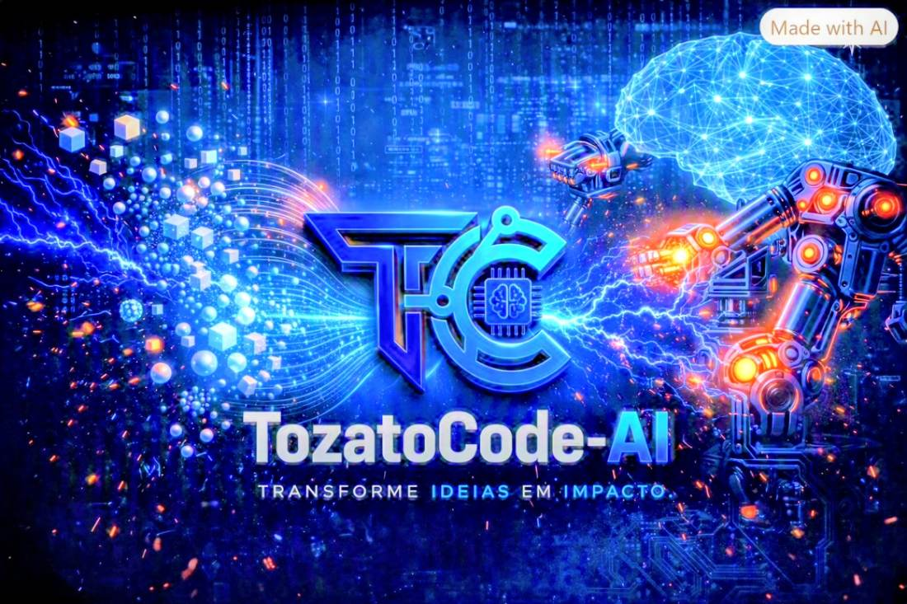

<p align="center">
  
</p>

# Tozato Dev Hub

Hub Profissional de Engenharia de Software, QA Automotivo/Industrial, Governança de Dados e Inteligência Artificial Local.

<p align="center">
  <!-- Linha 1: Core Frameworks & Linguagens -->
  <a href="https://nextjs.org/"></a>
  <a href="https://react.dev/"></a>
  <a href="https://www.typescriptlang.org/"></a>
  <a href="https://tailwindcss.com/"></a>
  <br>
  <!-- Linha 2: Arquitetura de IA Local & Quality Engineering -->
  <a href="https://ollama.com/"></a>
  <a href="https://huggingface.co/Qwen"></a>
  <a href="https://vercel.com/"></a>
  <a href="https://github.com/Rafael-TOZATO"></a>
</p>

---

## 📌 Visão Geral & Arquitetura

O **Tozato Dev Hub** é uma plataforma distribuída que integra portfólio executivo, central de validações técnicas, métricas de qualidade e um assistente conversacional otimizado para engenharia de software e análise de dados.

Projetado sob os pilares *Privacy-First* e *Offline-First*, o ecossistema permite alternar entre uma interface web de alta disponibilidade (Edge Deployment via Vercel) e um pipeline de inferência 100% local executado via **Ollama API (v1)** com a família de modelos **Qwen3.5 9B**. Essa abordagem híbrida garante processamento autônomo, eliminates custos por consumo de API comercial e assegura total conformidade e soberania sobre os dados.

---

## 📑 Dossiê Técnico & Documentação de Arquitetura

A documentação executiva completa do projeto — incluindo topologia de rede, testes de latência, consumo de VRAM e diretrizes de implantação em ambiente corporativo — está anexada diretamente ao repositório:

📄 **[Acessar Dossiê Técnico em PDF — Agente de Código Offline](./Dossie%20Tecnico%20-%20Agente%20de%20Codigo%20Offline%20%281%29.pdf)**

---

## 🚀 Guia de Implantação e Execução Offline

### Pré-requisitos de Hardware & Runtime
* **Ollama Runtime**: Instalação ativa no ambiente local.
* **Recursos de Memória**: Mínimo de 16 GB de RAM/VRAM (24 GB recomendado para processamento com janela de contexto estendida de 65.536 tokens).
* **Storage**: ~7.5 GB para o checkpoint do modelo `qwen3.5:9b`.

### 1. Servidor de Inferência Local (Ollama Endpoint)
Em um terminal dedicado, inicialize o modelo com parâmetros de contexto estendido e isolamento de nuvem:

```bash
ollama pull qwen3.5:9b
OLLAMA_HOST=127.0.0.1:11434 OLLAMA_NO_CLOUD=1 OLLAMA_CONTEXT_LENGTH=65536 ollama serve
