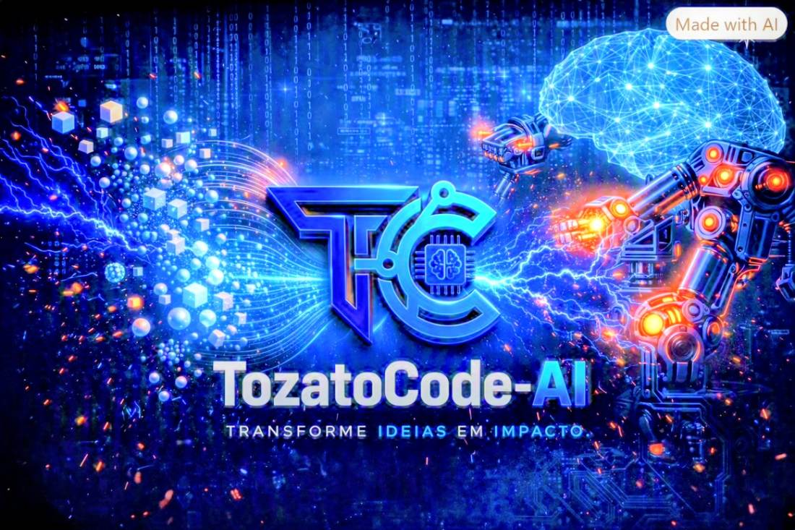

<p align="center">
  
</p>

# Tozato Core AI

Hub Profissional de Engenharia de Software, QA Automotivo/Industrial, Governança de Dados e Inteligência Artificial Local.

<p align="center">
  <!-- MÁXIMO IMPACTO PROFISSIONAL & ENGAJAMENTO DE GOVERNANÇA -->
  <a href="https://github.com/Rafael-TOZATO/tozato-ai-core/commits/main"></a>
  <a href="https://github.com/Rafael-TOZATO/tozato-ai-core/stargazers"></a>
  <a href="https://github.com/Rafael-TOZATO/tozato-ai-core/network/members"></a>
  <a href="https://github.com/Rafael-TOZATO/tozato-ai-core/actions/workflows/nextjs-ci.yml"></a>
  <a href="https://github.com/Rafael-TOZATO/tozato-ai-core/actions/workflows/codeql.yml"></a>
  <br>
  <!-- STACK ARQUITETURAL CORE -->
  <a href="https://nextjs.org/"></a>
  <a href="https://www.typescriptlang.org/"></a>
  <a href="https://ollama.com/"></a>
  <a href="https://github.com/Rafael-TOZATO"></a>
</p>

---

## 📌 Visão Geral & Arquitetura

O **Tozato Dev Hub** é uma plataforma distribuída que integra portfólio executivo, central de validações técnicas, métricas de qualidade e um assistente conversacional otimizado para engenharia de software e análise de dados.

Projetado sob os pilares *Privacy-First* e *Offline-First*, o ecossistema permite alternar entre uma interface web de alta disponibilidade (Edge Deployment via Vercel) e um pipeline de inferência 100% local executado via **Ollama API (v1)** com a família de modelos **Qwen3.5 9B**. Essa abordagem híbrida garante processamento autônomo, elimina custos por consumo de API comercial e assegura total conformidade e soberania sobre os dados.

---

## 📑 Dossiê Técnico & Documentação de Arquitetura

A documentação executiva completa do projeto — incluindo topologia de rede, testes de latência, consumo de VRAM e diretrizes de implantação em ambiente corporativo — está anexada diretamente ao repositório:

📄 **[Acessar Dossiê Técnico em PDF — Agente de Código Offline](./Dossie%20Tecnico%20-%20Agente%20de%20Codigo%20Offline%20%281%29.pdf)**

---

## 🚀 Guia de Implantação e Execução Offline

### Pré-requisitos de Hardware & Runtime
* **Ollama Runtime**: Instalação ativa no ambiente local.
* **Recursos de Memória**: Mínimo de 16 GB de RAM/VRAM (24 GB recomendado para processamento com janela de contexto estendida de 65.536 tokens).
* **Storage**: ~7.5 GB para o checkpoint do modelo `qwen3.5:9b`.

### 1. Servidor de Inferência Local (Ollama Endpoint)
Em um terminal dedicado, inicialize o modelo com parâmetros de contexto estendido e isolamento de nuvem:

```bash
ollama pull qwen3.5:9b
OLLAMA_HOST=127.0.0.1:11434 OLLAMA_NO_CLOUD=1 OLLAMA_CONTEXT_LENGTH=65536 ollama serve
```
---

## 🤝 Contribuição e Governança

Contribuições e relatos de bugs são bem-vindos para o aprimoramento contínuo da plataforma.

* **Reportar Bugs:** Abra uma [Issue de Bug](https://github.com/Rafael-TOZATO/tozato-ai-core/issues/new?template=bug_report.md) detalhando o comportamento esperado, Logs e ambiente de execução (Ollama / Vercel).
* **Sugestões de Features:** Abra uma [Issue de Melhoria](https://github.com/Rafael-TOZATO/tozato-ai-core/issues/new?template=feature_request.md).
* **Pull Requests:** Antes de enviar um PR, certifique-se de vincular a uma issue existente para validação do Quality Gate.

Para mais detalhes sobre os padrões de commits e arquitetura, consulte o nosso [Guia de Contribuição](./CONTRIBUTING.md).

---


## 🔐 Segurança e Governança

O projeto aplica controles preventivos e verificações automatizadas ao código-fonte, às dependências e ao processo de integração contínua, sem interferir na interface visual ou nos componentes de interação.

### Controles implementados

* **API e proteção de dados:** chave Gemini mantida exclusivamente no ambiente do servidor e transmitida pelo cabeçalho `x-goog-api-key`; mensagens limitadas a 8.000 caracteres; até 5 anexos e 4 MB no total; corpo HTTP limitado a 4,4 MB; histórico limitado; timeout de 30 segundos para o serviço externo.
* **Tratamento de erros:** respostas externas não são repassadas ao cliente nem registradas integralmente nos logs; respostas inválidas, limites excedidos e timeout recebem tratamento específico.
* **Cabeçalhos HTTP:** proteção contra MIME sniffing, clickjacking e exposição excessiva de referenciador; política de permissões para recursos do navegador; respostas da API sem cache.
* **Dependências:** Next.js 16.4.5 e React/React DOM 19.2.9, com atualização direcionada para versões corrigidas dos avisos de segurança publicados em novembro de 2026.
* **Quality Gate:** instalação controlada pelo pnpm, auditoria de vulnerabilidades com bloqueio a partir de severidade alta, validação TypeScript e build de produção.
* **SAST:** análise estática CodeQL com consultas `security-extended` e `security-and-quality`, executada em push, pull request e agenda semanal.
* **Governança de dependências:** Dependabot configurado para monitoramento e atualização semanal das dependências de produção e desenvolvimento.

### Verificações automatizadas

- [Quality Gate](https://github.com/Rafael-TOZATO/tozato-ai-core/actions/workflows/nextjs-ci.yml)
- [CodeQL Security Analysis](https://github.com/Rafael-TOZATO/tozato-ai-core/actions/workflows/codeql.yml)
- [Dependabot](https://github.com/Rafael-TOZATO/tozato-ai-core/network/updates)

Os indicadores de status no cabeçalho refletem as execuções dos workflows do GitHub Actions. A aprovação final depende da conclusão dos pipelines após cada atualização.

---

## 💻 PROJETOS E PORTFÓLIOS
- **App Ecosystem:** [tozato-ai-core.vercel.app](https://tozato-ai-core.vercel.app)
- **H-Folio:** [h-folio-l0.vercel.app](https://h-folio-l0.vercel.app)

---

## 🐙 CÓDIGO E REPOSITÓRIOS
- **GitHub:** [github.com/Rafael-TOZATO](https://github.com/Rafael-TOZATO)

---

## ✍️ ARTIGOS E PUBLICAÇÕES
- **Medium:** [medium.com/@ornelas.tozato](https://medium.com/@ornelas.tozato)

---

## 📬 CONTATOS
- **E-mail:** [ornelas.tozato@gmail.com](mailto:ornelas.tozato@gmail.com)
- **LinkedIn:** [rafaeltozato81](https://www.linkedin.com/in/rafaeltozato81)
- **GitHub:** [Rafael-TOZATO](https://github.com/Rafael-TOZATO)
- **Dev Hub:** [tozato-ai-core.vercel.app](https://tozato-ai-core.vercel.app)

